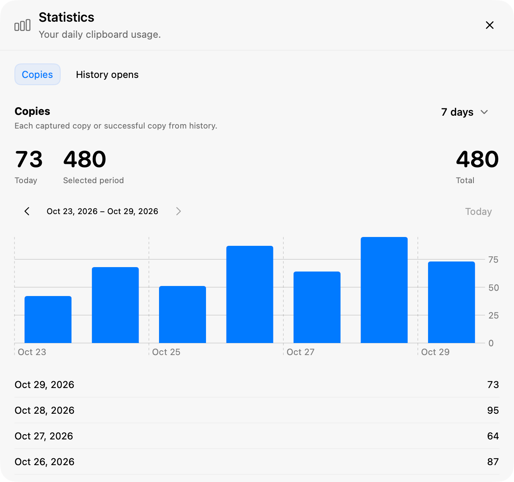

  

<h1 align="center">Pasket</h1>

A little basket for everything you copy.

  A clipboard manager for macOS. Find an earlier copy, paste several items together, 
  or work through a queue without losing your place.

  <a href="https://github.com/acehinnnqru/pasket/releases/latest">Download for macOS</a> ·
  <a href="#features">Features</a> ·
  <a href="#getting-started">Getting started</a>

## Features

### Find and preview earlier copies

Keep text, links, email addresses, images, and file references in one searchable
history. Search saved text or the source app with keywords, initials, or fuzzy
matches (`hlo` finds `hello`). Ordinary matches appear first; scroll to the end or choose
**Find broader matches** to expand the search. Empty levels expand automatically, and fuzzy
matches stay within a line with limited character gaps. Filter by content type, browse entries grouped by
date, and preview text and images before choosing what to paste.

Open Pasket from the menu bar or your own shortcut. Start typing to search, use
the arrow keys to choose an entry, and press **Return** to paste into the app you
were using. **Escape** closes history and takes you back to your work.

### Paste several things together

Select multiple entries with **Command-click**, **Shift-click**, or **Tab**,
or use **Select Recent** (**Shift-Tab**) to select your latest batch of copies,
then choose **Paste Together**:

- Combine text, links, and emails with a new line, space, blank line, or no separator.
- Paste multiple file entries as a group.
- Paste several images together in apps that support multiple clipboard images.

**Reverse Order** is on by default for both Paste Together and Paste Queue, so
items paste from bottom to top. Turn it off in the paste options menu when needed.

### Fill one field at a time

Use **Start Paste Queue** to work through a selection in order. Pasket pastes the
first item; move to the next field or app and use **Paste Next** for the next one.
If no Paste Next shortcut is set, Pasket offers to configure one before starting.
You can also use the panel and menu bar controls.

Queues support text, links, emails, images, and files individually, so a selection
can contain different types. Use a queue for mixed content or when an app needs
images pasted one at a time. The next item and remaining count stay visible.
Copying something new cancels the queue.

### Choose your appearance

**Liquid Glass**, the default, uses native macOS glass and follows the system's
appearance and transparency preferences. Choose **Classic** in Settings for
frosted surfaces. Both follow your system's light or dark appearance.

Choose the system accent color or your own, and pick from six Dock icon colors.
Appearance changes apply immediately and stay saved across launches.

### See your daily usage

Open **Statistics** from the menu bar to view **Copies** and **History opens**.
Each page shows today's count, the selected period, and an overall total, with
**7-, 30-, or 90-day** charts and daily counts. Browse earlier periods to see how
your usage changes over time.

Counts are saved on your Mac independently of history retention. Copies starts
with an estimate from existing saved entries; earlier repeats and deleted items
cannot be recovered. New captured copies and successful clipboard writes from
history count each time, including repeats.

### Keep control of your history

History is stored locally, with no account or cloud service required. Pause and
resume collection whenever you need to. Pasket skips clipboard entries marked
as concealed, transient, or automatically generated; unmarked content is
collected normally.

Choose your own retention limits for entry count, age, and text or image storage.
The defaults keep up to **2,026 entries** for **60 days**, within **50 MiB of text**
and **500 MiB of images**. Each limit can also be set to Unlimited.

Files stay in their original locations: history stores references, rather than
backups. Removing an entry from Pasket never deletes the original file.

### Fit Pasket into your workflow

- **Menu bar access**, with an optional Dock icon and **Start at Login**.
- **Custom shortcuts** for history, Settings, deleting selections, and Paste Next.
- **Remembered type filters** for a duration you choose.
- **History cleanup**, including an optional setting to recycle unavailable file references.

## Getting started

Requires **macOS 26 or later**. Release builds support **Apple Silicon and Intel**.

1. Download the DMG or ZIP from [GitHub Releases](https://github.com/acehinnnqru/pasket/releases/latest).
2. Move **pasket.app** to **Applications** and open it.
3. Follow the setup guide to allow clipboard collection and grant **Accessibility**
   access for automatic paste. If prompted, quit and reopen Pasket to apply access.
4. Set a history shortcut, or continue with menu bar access. No history shortcut
   is assigned by default.
5. Copy something, open **Clipboard History** from the menu bar, and press
   **Return** on an entry to paste it.

## Development

For building from source, detailed behavior, storage, and validation, see the
[development guide](docs/DEVELOPMENT.md). Maintainers can find versioning,
signing, notarization, and publishing instructions in the
[release guide](docs/RELEASING.md).

## License

[MIT](LICENSE)

Screenshots show Liquid Glass in a light system appearance with fictional sample content.
